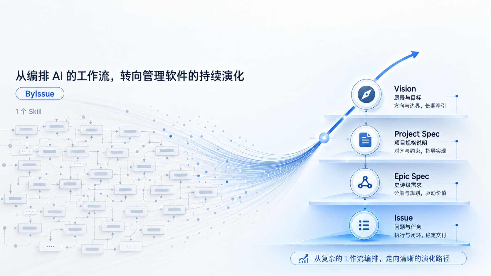

<div align="center">

# ByIssue v2



**Keep agents on track. Verify completion through real behavior.**

[中文](README.md) · **English**

[Quick start](#quick-start) · [Usage](#usage) · [Project files](#project-files) · [Local checks](#local-checks)

</div>

ByIssue is an Agent Skill named **`bi`** for AI-assisted software development. It keeps goals, constraints, the next action, and verification evidence in your project so an agent can resume after a long task, context compaction, or a new session.

Describe what you need. `bi` chooses between clarification, change, understanding and review, or memory and direction. Small changes get direct verification; cross-session work, multiple behavior paths, and completeness-sensitive tasks get a work checkpoint.

## Quick start

You need a coding agent that supports Agent Skills, Node.js 22.20+, and Git. Workspace initialization uses Python 3.

### 1. Install from the v2 branch

Run this in your project directory:

```bash
npx skills add https://github.com/ByteTrue/ByIssue/tree/v2 --skill bi
```

Select your coding agent when prompted. Installation is project-local by default; add `-g` for a global installation. Run the same command again to update v2 or switch from another version.

> [!IMPORTANT]
> The `tree/v2` URL selects the v2 branch. Using only the repository name installs the default branch.

### 2. Onboard your project

Tell your agent:

```text
Use bi to onboard ByIssue in this project.
```

The agent creates `byissue/work/` and `byissue/memory/`, preserving existing content. Then describe your task:

```text
Use bi to migrate amounts in every legacy CSV to integer cents. Preserve the source files and verify the real import command.
```

### Use with pi

```bash
npx skills add https://github.com/ByteTrue/ByIssue/tree/v2 --skill bi -a pi -y
pi
```

In the pi session:

```text
/skill:bi Onboard ByIssue in this project, then help me clarify this change.
```

For other agents, use their supported skill invocation syntax.

## Usage

| What you need | Example request | Outcome |
|---|---|---|
| Clarify | “Settle the rules for stacking coupons before changing code.” | Confirmed goals, vocabulary, and trade-offs |
| Change | “Fix duplicate invoices caused by repeated imports.” | Implementation, real verification, and a work entry when needed |
| Understand and review | “How does this payment path work?” “Review this diff.” | A bounded explanation or review with sources |
| Memory and direction | “Remember that money always uses integer cents.” “Shape the next milestone.” | Topic-based Memory and optional Vision |

Prefix your request with “Use bi.” The agent asks you about product boundaries and trade-offs that only you can decide, and checks facts available in the project itself.

### Pause and resume

```text
Finish the importer this session. Leave reporting for next time.
```

In a new session:

```text
Use bi to continue the invoice migration.
```

The agent resumes from the work checkpoint and checks it against actual files and evidence. If several work entries match, it asks you to choose. Changed requirements also require affected behavior to be verified again.

## Project files

```text
byissue/
├── work/
│   └── {slug}/
│       ├── index.md       # goal, checkpoint, and behavior proof
│       └── scope.md       # created when full scope accounting is needed
├── memory/
│   └── {topic}.md         # durable decisions, external facts, rerunnable proof
└── vision/               # created when shaping long-term direction
    └── index.md
```

Each work entry keeps five checkpoint fields at the top of `index.md`:

| Field | Question it answers |
|---|---|
| `status` | Is the work in progress, blocked, or complete? |
| `current_unit` | Which behavior is being worked on? |
| `next_action` | What is the first action to take next? |
| `must_hold` | Which confirmed constraints must remain true? |
| `proof_gap` | What evidence or scope accounting is still missing? |

`kind: work` identifies the document type. Code, configuration, tests, and git remain the source of implementation facts. Memory holds future-useful decisions that cannot be reconstructed directly from those sources.

### What counts as complete?

- **Behavior proof:** exercise the real UI, CLI, API, or other actual entry point; observe the expected result and relevant side effects; record evidence.
- **Scope coverage:** for migrations, rewrites, ports, and “all X” tasks, enumerate the source of truth and account for every item.

Full scope coverage still requires behavior verification. A path that cannot be exercised stays inconclusive. File existence or passing adjacent tests cannot establish completion. See [`skills/bi/SKILL.md`](skills/bi/SKILL.md) for the full contract.

## Local checks

Maintainers need Python 3 and Bash:

```bash
bash tools/release-check.sh --no-deploy
```

This checks the skill package, references, version records, templates, and initialization script. Pass the skill directory your agent actually loads to compare the installed files as well:

```bash
bash tools/release-check.sh /path/to/installed/bi
```

Only [`skills/bi/`](skills/bi/) is distributed. [`tools/`](tools/) contains maintainer checks, [`byissue/memory/project.md`](byissue/memory/project.md) holds project constraints, and [`archive/v1/`](archive/v1/) contains v1 history. Inputs, acceptance checks, and results for the pi task are in the [v2 evaluation record](byissue/work/v2-readiness/evaluation/README.md).

---

Based on [CodeStable](https://github.com/liuzhengdongfortest), maintained by [ByteTrue](https://github.com/ByteTrue). Read [why ByIssue exists](WHY%20BYISSUE.md) (Chinese).
