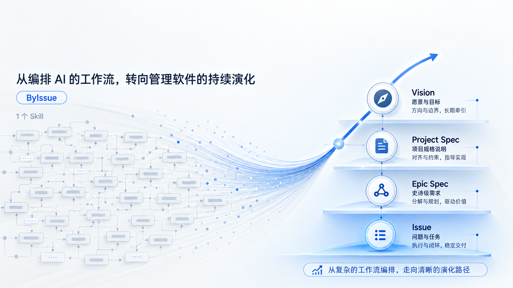

<div align="center">

# ByWork v2



**Keep agents on track. Verify completion through real behavior.**

[中文](README.md) · **English**

[Quick start](#quick-start) · [Usage](#usage) · [Project files](#project-files) · [Local checks](#local-checks)

</div>

ByWork is an Agent Skill named **`bw`** for AI-assisted software development. It keeps goals, constraints, the next action, and verification evidence in your project so an agent can resume after a long task, context compaction, or a new session.

Describe what you need. `bw` chooses between clarification, change, understanding and review, or memory and direction. Small changes get direct verification; cross-session work, multiple behavior paths, and completeness-sensitive tasks get a work checkpoint.

## Quick start

You need a coding agent that supports Agent Skills, Node.js 22.20+, and Git. Workspace initialization uses Python 3.

### 1. Install from the v2 branch

Run this in your project directory:

```bash
npx skills add https://github.com/ByteTrue/ByWork/tree/v2 --skill bw
```

Select your coding agent when prompted. Installation is project-local by default; add `-g` for a global installation. Run the same command again to update v2 or switch from another version.

> [!IMPORTANT]
> The `tree/v2` URL selects the v2 branch. Using only the repository name installs the default branch.

### 2. Onboard your project

Tell your agent:

```text
Use bw to onboard ByWork in this project.
```

The agent creates `bywork/work/` and `bywork/memory/`, preserving existing content. Then describe your task:

```text
Use bw to migrate amounts in every legacy CSV to integer cents. Preserve the source files and verify the real import command.
```

### Use with pi

```bash
npx skills add https://github.com/ByteTrue/ByWork/tree/v2 --skill bw -a pi -y
pi
```

In the pi session:

```text
/skill:bw Onboard ByWork in this project, then help me clarify this change.
```

For other agents, use their supported skill invocation syntax.

## Usage

| What you need | Example request | Outcome |
|---|---|---|
| Clarify | “Settle the rules for stacking coupons before changing code.” | Confirmed goals, vocabulary, and trade-offs |
| Change | “Fix duplicate invoices caused by repeated imports.” | Implementation, real verification, and a work entry when needed |
| Understand and review | “How does this payment path work?” “Review this diff.” | A bounded explanation or review with sources |
| Memory and direction | “Remember that money always uses integer cents.” “Shape the next milestone.” | Topic-based Memory and optional Vision |

Prefix your request with “Use bw.” The agent asks you about product boundaries and trade-offs that only you can decide, and checks facts available in the project itself.

### Pause and resume

```text
Finish the importer this session. Leave reporting for next time.
```

In a new session:

```text
Use bw to continue the invoice migration.
```

When continuing, the agent first reads the current work checkpoint, then checks actual files and evidence; continuation from a compaction summary works the same way. If several work entries match, it asks you to choose.

Implementation proceeds one row of the behavior proof table at a time: select one user behavior, save the checkpoint, implement, verify from the real public entry point, write the actual result back, then select the next row. Verification holds the contract: public CLI/API proof preserves the raw output seen by the real caller; a shared-path change captures a baseline of the old behavior first and re-verifies through the same entry point afterwards; explicit retain/archive policy branches are each verified; persistence, restart, and lifecycle behavior is observed through a new process or restart entry point; existing tests and public fixtures keep their original files and assertions, with new regressions in new files.

Before closing, the agent reconciles the proof table, scope, and external acceptance results item by item and names every failure in `proof_gap`. Only a fully passing proof with `proof_gap` exactly empty may use `status: complete`; any failed acceptance, missing raw output, or rewritten existing test keeps the work incomplete with the gaps named.

Installed skills, evaluation cases, and runner materials are read-only during a run. Process records go in the project's `bywork/`; skill changes go back to the skill source repository.

The user's original requirements or stable sources are retained with their conditions and exceptions. Deferred behavior also keeps its confirmed input/output formats and error boundaries so the next session has a complete contract to implement.

## Project files

```text
bywork/
├── work/
│   └── {slug}/
│       ├── index.md       # goal, checkpoint, and behavior proof
│       └── scope.md       # created when full scope accounting is needed
├── memory/
│   └── {topic}.md         # durable decisions, external facts, rerunnable proof
└── vision/               # created when shaping long-term direction
    └── index.md
```

Each work entry keeps five checkpoint fields at the top of `index.md`:

| Field | Question it answers |
|---|---|
| `status` | Is the work in progress, blocked, or complete? |
| `current_unit` | Which behavior is being worked on? |
| `next_action` | What is the first action to take next? |
| `must_hold` | Which confirmed constraints must remain true? |
| `proof_gap` | What evidence or scope accounting is still missing? |

`kind: work` identifies the document type. Code, configuration, tests, and git remain the source of implementation facts. Memory holds decisions useful across tasks that cannot be reconstructed directly from those sources. Current handoff details stay in work; Memory can remain empty when nothing qualifies.

### What counts as complete?

- **Behavior proof:** exercise the real UI, CLI, API, or other actual entry point; observe the expected result and relevant side effects; record evidence.
- **Scope coverage:** for migrations, rewrites, ports, and “all X” tasks, enumerate the source of truth and account for every item.

Full scope coverage still requires behavior verification. Before completion, each requirement must map to proof, and actual assertions must cover every promise in that proof. Unexercised paths stay inconclusive. File existence or passing adjacent tests cannot establish completion. See [`skills/bw/SKILL.md`](skills/bw/SKILL.md) for the full contract.

## Local checks

Maintainers need Python 3 and Bash:

```bash
bash tools/release-check.sh --no-deploy
```

This checks the skill package, references, version records, templates, and initialization script. Pass the skill directory your agent actually loads to compare the installed files as well:

```bash
bash tools/release-check.sh /path/to/installed/bw
```

Use the [evaluation procedure](tools/evaluation/README.md) to check real skill behavior with fixed inputs, a fresh installation, independent pi sessions, business acceptance, and item-by-item workflow review.

Only [`skills/bw/`](skills/bw/) is distributed. [`tools/`](tools/) contains maintainer checks, [`bywork/memory/project.md`](bywork/memory/project.md) holds project constraints, and [`archive/v1/`](archive/v1/) contains v1 history. Inputs, acceptance checks, and results for the first pi task are in the [v2 evaluation record](bywork/work/v2-readiness/evaluation/README.md).

---

Based on [CodeStable](https://github.com/liuzhengdongfortest), maintained by [ByteTrue](https://github.com/ByteTrue). Read [why ByWork exists](WHY%20BYWORK.md) (Chinese).
