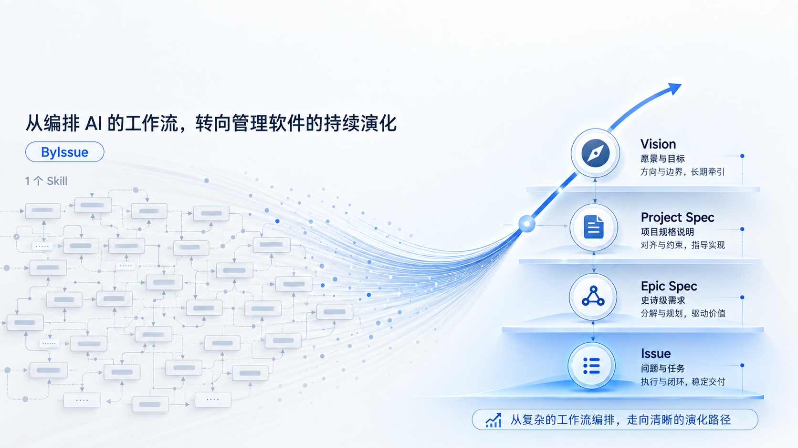

<div align="center">

# ByIssue v2



**让 Agent 接着做对的事，用真实结果证明完成。**

**中文** · [English](README.en.md)

[快速开始](#快速开始) · [怎么用](#怎么用) · [工作如何保存](#工作如何保存) · [本地验证](#本地验证)

</div>

ByIssue 是一个名为 **`bi`** 的 Agent Skill，用于 AI 辅助软件开发。它把目标、约束、下一步和验证证据留在项目中，帮助 Agent 在长任务、上下文压缩和新会话之后继续工作。

你说要做什么，`bi` 根据任务选择澄清、改变、理解与审查，或记忆与方向。小改直接验证；跨会话、多条行为路径和需要完整范围核对的任务建立工作检查点。

## 快速开始

需要支持 Agent Skills 的编码助手，以及 Node.js 22.20+ 和 Git。初始化工作目录使用 Python 3。

### 1. 从 v2 分支安装

在要使用 ByIssue 的项目目录运行：

```bash
npx skills add https://github.com/ByteTrue/ByIssue/tree/v2 --skill bi
```

按提示选择编码助手。默认安装到当前项目；加 `-g` 可全局安装。更新 v2 或从其他版本切到 v2 时，重新运行同一条命令。

> [!IMPORTANT]
> 安装地址中的 `tree/v2` 指定 v2 分支。仅使用仓库名会安装默认分支的内容。

### 2. 接入项目

在助手中输入：

```text
使用 bi，在这个项目接入 ByIssue。
```

Agent 会建立 `byissue/work/` 和 `byissue/memory/`，已有内容保留。随后直接告诉它目标：

```text
使用 bi，把所有旧 CSV 的金额迁移为整数分，保留原始数据，并验证实际导入入口。
```

### 在 pi 中使用

```bash
npx skills add https://github.com/ByteTrue/ByIssue/tree/v2 --skill bi -a pi -y
pi
```

在 pi 会话中输入：

```text
/skill:bi 在这个项目接入 ByIssue，然后帮我理清这次改动。
```

其他助手按各自的技能调用方式使用 `bi`。

## 怎么用

| 你现在要做什么 | 可以这样说 | 得到什么 |
|---|---|---|
| 澄清目标 | “先聊清楚优惠券叠加的边界，再动代码。” | 确认目标、术语和取舍 |
| 改变软件 | “修复重复导入产生重复账单的问题。” | 实现、真实入口验证，必要时建立 work |
| 理解与审查 | “这条支付链路怎么工作？”“评审这个 diff。” | 有范围、有出处的解释或审查结果 |
| 记忆与方向 | “记住金额始终用整数分。”“整理下一阶段的方向。” | 按主题保存 Memory，按需整理 Vision |

这些请求前加上“使用 bi”即可。遇到只有你能决定的产品边界或取舍，Agent 会提问；能从项目和运行中查明的事实由它自己核对。

### 中途停下，再继续

```text
这轮先完成导入，报表留到下一次。
```

下一次会话：

```text
使用 bi，继续账单迁移。
```

Agent 从当前 work 的检查点接续，核对实际文件和证据。存在多个同主题工作时，它会请你选择。任务中途改变要求时，受影响的验证也要重新做。

## 工作如何保存

```text
byissue/
├── work/
│   └── {slug}/
│       ├── index.md       # 本次目标、检查点和行为证明
│       └── scope.md       # 需要完整范围核对时创建
├── memory/
│   └── {topic}.md         # 长期决定、外部事实、可重跑证明
└── vision/               # 整理长期方向时按需创建
    └── index.md
```

每个 work 的 `index.md` 顶部保存五项检查点：

| 字段 | 回答的问题 |
|---|---|
| `status` | 正在做、被阻塞，还是已完成？ |
| `current_unit` | 当前正在验证哪段行为？ |
| `next_action` | 接下来先做哪一件事？ |
| `must_hold` | 哪些已确认约束必须守住？ |
| `proof_gap` | 还缺什么证据或范围核对？ |

`kind: work` 标识文档类型。代码、配置、测试和 git 保留实现事实；Memory 只记录未来仍需要、无法从这些事实直接重建的判断。

### 怎样算完成

- **行为证明**：从真实 UI、CLI、API 或其他实际入口操作，观察预期结果和关键副作用，记录证据。
- **范围覆盖**：迁移、重写、移植和“所有 X”任务，从事实源列出范围，逐项对账。

范围全部覆盖仍需行为验证。无法运行的路径会标为“无法判定”，不能靠文件存在或局部测试通过宣布完成。完整契约见 [`skills/bi/SKILL.md`](skills/bi/SKILL.md)。

## 本地验证

维护仓库时，使用 Python 3 和 Bash 运行：

```bash
bash tools/release-check.sh --no-deploy
```

这会检查技能包、引用路径、版本记录、模板和初始化脚本。传入助手实际加载的技能目录，还会逐文件比较安装副本：

```bash
bash tools/release-check.sh /path/to/installed/bi
```

仓库只分发 [`skills/bi/`](skills/bi/)。[`tools/`](tools/) 保存维护检查，项目约束在 [`byissue/memory/project.md`](byissue/memory/project.md)，v1 历史材料集中在 [`archive/v1/`](archive/v1/)。pi 实际任务的输入、验收与结果见 [v2 实测记录](byissue/work/v2-readiness/evaluation/README.md)。

---

基于 [CodeStable](https://github.com/liuzhengdongfortest)，由 [ByteTrue](https://github.com/ByteTrue) 维护。了解[为什么做 ByIssue](WHY%20BYISSUE.md)。
